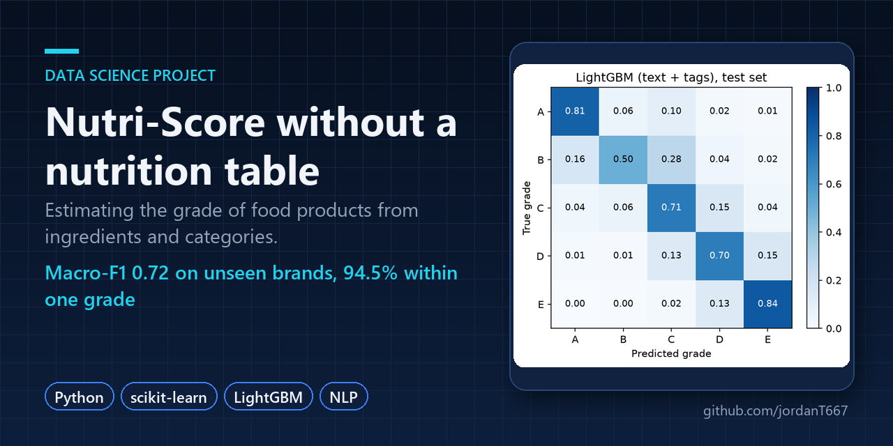
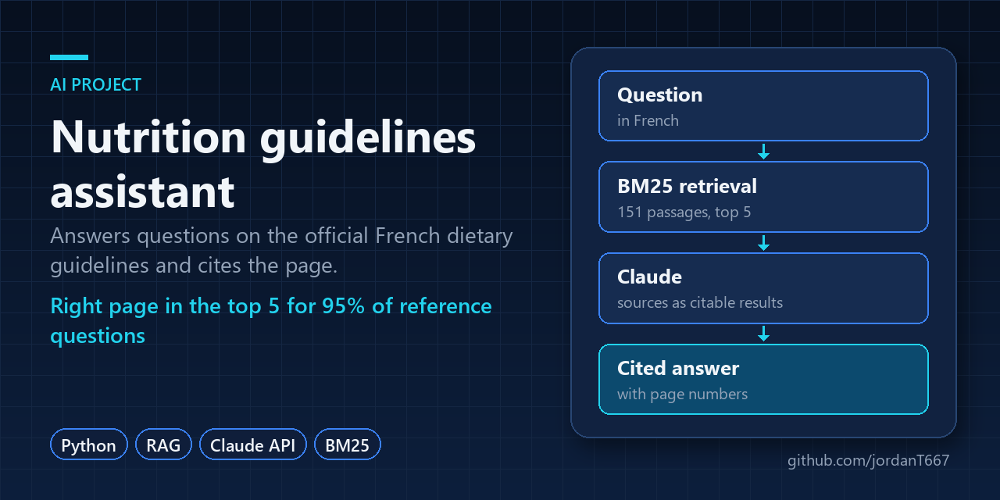
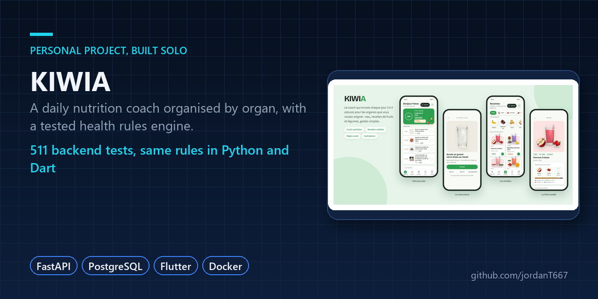
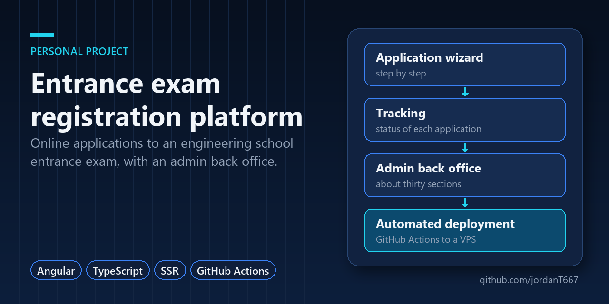
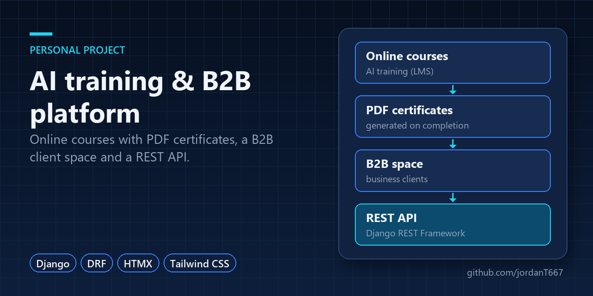

<picture>
  <source media="(prefers-color-scheme: light)" srcset="assets/banner-light.svg">
  
</picture>

  
  
  
  
  

I build data and AI products in health tech, end to end: from the data and the model to the API and the mobile app that people actually use.
I hold an MSc in Data Science & AI and I am based in Douala, Cameroon. **I am currently looking for a professional internship.**

### What I work on

| Domain | Focus |
|---|---|
| **Data Science** | Data cleaning, exploratory analysis, statistical modelling, machine learning, dashboards for decision makers |
| **Artificial Intelligence** | Model training and evaluation, deep learning, LLM applications |
| **Software Engineering** | Python APIs (FastAPI, Django), PostgreSQL, Angular and Flutter front ends, Docker, CI/CD |

### Featured projects

<table>
<tr>
<td width="50%" valign="top">

<b><a href="https://github.com/jordanT667/nutriscore-ml">Nutri-Score without a nutrition table</a></b> · <i>data science</i> 
Estimates the grade of 265,691 Open Food Facts products from ingredients and categories. LightGBM, brand-grouped split: macro-F1 0.72 on unseen brands (0.61 for the category baseline), 94.5% within one grade.
</td>
<td width="50%" valign="top">

<b><a href="https://github.com/jordanT667/nutrition-rag">Nutrition guidelines assistant</a></b> · <i>AI</i> 
Answers questions on the official French dietary guidelines and cites the page. BM25 finds the right page in the top 5 for 95% of reference questions; evaluation harness on 50 questions, 10 of them unanswerable.
</td>
</tr>
<tr>
<td width="50%" valign="top">

<b><a href="https://github.com/jordanT667/kiwia">KIWIA</a></b> · <i>personal project, built solo</i> 
A daily nutrition coach organised by organ: FastAPI backend with a tested rules engine (511 tests), PostgreSQL, and a Flutter app running the same rules in Dart. Showcase repository, source private.
</td>
<td width="50%" valign="top">

<b><a href="https://github.com/jordanT667/concours">Entrance exam registration platform</a></b> · <i>personal project</i> 
Angular SSR platform for applying to an engineering school entrance exam, with an admin back office and automated deployment to a VPS with GitHub Actions.
</td>
</tr>
<tr>
<td width="50%" valign="top">

<b><a href="https://github.com/jordanT667/ProjetST">AI training & B2B platform</a></b> · <i>personal project</i> 
Django platform combining online courses with PDF certificates, a B2B client space, an admin dashboard and a REST API.
</td>
<td width="50%" valign="top">
<b>Vitallink</b> · <i>private project, medical domain</i>
</td>
</tr>
</table>

### Tech stack

  
  &nbsp;
  
  &nbsp;
  

Also: Pandas, NumPy, Jupyter, data visualisation, REST API design, Git.

**Currently learning:** Rust and Java.

  

### GitHub activity

  

  
  

### Experience

- **Junior Data Scientist** · Infinity Tech · Internship · Jul 2024 – Oct 2025
  Data preparation and analysis, dashboards and reporting for business teams.
- **Junior Developer & Designer** · Gestmarter · Internship · Jul 2023 – Sep 2024
  Restaurant and travel apps, websites and platforms for organisations, from UI design to implementation.

### Education

- **MSc Data Science & AI** · École nationale supérieure polytechnique de Douala · 2026
- **BSc** in the same school and track

### Currently

- Running the answer-quality evaluation of the nutrition guidelines assistant.
- Looking for a **professional internship** in data science or AI, in Douala, hybrid or remote.

### Contact

📫 [namekongj0@gmail.com](mailto:namekongj0@gmail.com) · 🌐 [jordant667.github.io](https://jordant667.github.io) · 💼 [linkedin.com/in/jordan-namekong](https://www.linkedin.com/in/jordan-namekong)

<b>🇫🇷 En français</b>

 

Je conçois des produits data et IA dans la santé, de bout en bout : des données et du modèle jusqu'à l'API et à l'application mobile utilisée au quotidien.
Diplômé d'un master Data Science & IA, je vis à Douala et **je recherche un stage professionnel** en data science ou en IA.

Projets à découvrir ci-dessus : une **estimation du Nutri-Score sans tableau nutritionnel** (machine learning sur Open Food Facts), un **assistant de questions-réponses sur les recommandations nutritionnelles officielles** (RAG avec citations), **KIWIA** (coach nutritionnel, FastAPI, PostgreSQL, Flutter), une **plateforme d'inscription à un concours** (Angular) et une **plateforme de formation IA et de services B2B** (Django).

